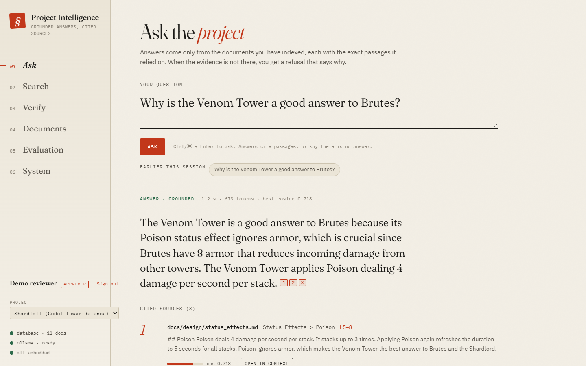
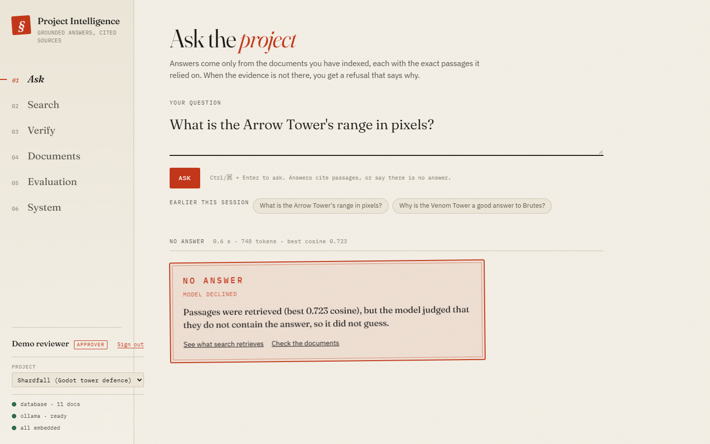
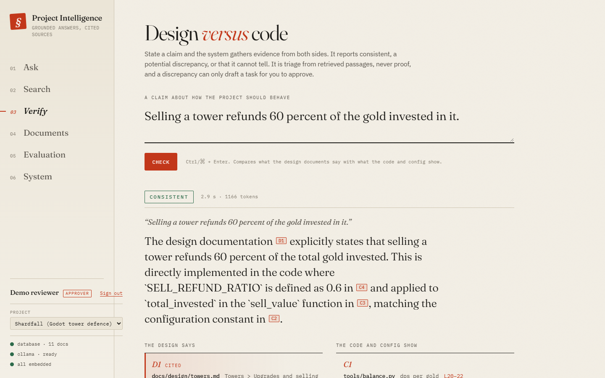
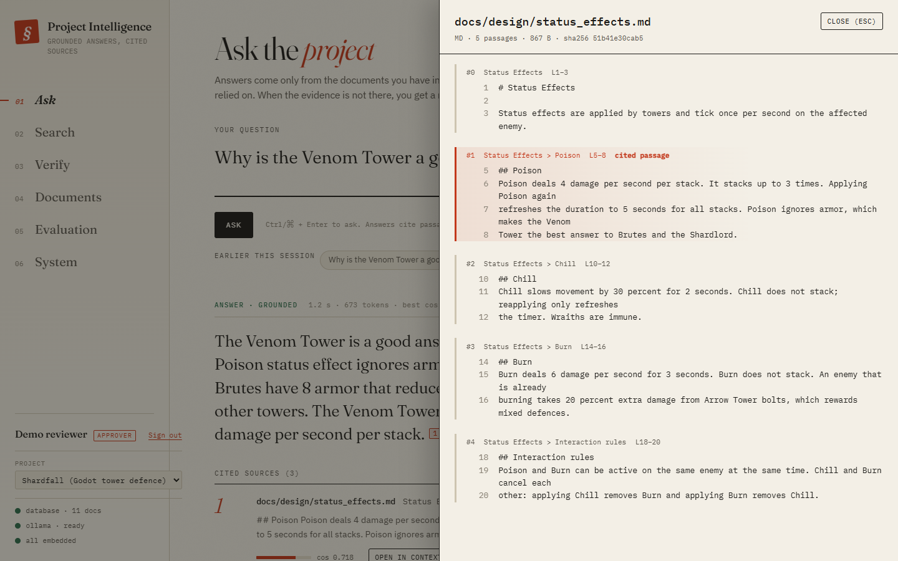
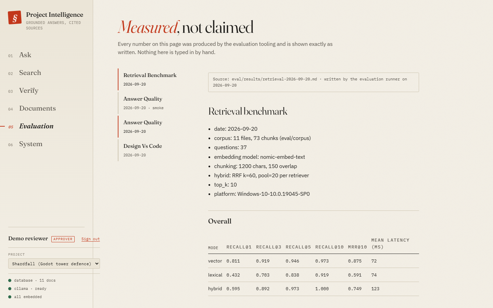
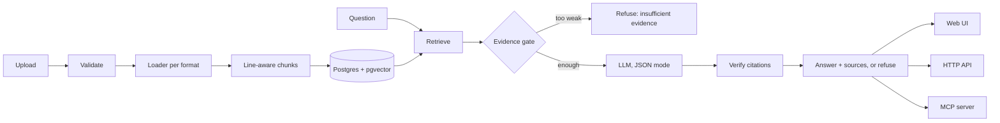

# Project Intelligence RAG

Ask questions about a software project's design docs **and** source code, and get answers with
citations to the exact file, section and line range, or an explicit refusal when the evidence is not
there. Built without LangChain or LlamaIndex so every stage can be explained, and measured with its
own evaluation tooling.



**Stack:** Python 3.11 · FastAPI · PostgreSQL + pgvector · Ollama (local `qwen3.5` +
`nomic-embed-text`) or any OpenAI-compatible API · MCP · Docker · 601 tests
**Runs fully local:** no API keys, no data leaves the machine.

## What it does

- **Grounded Q&A with verified citations.** The model must cite retrieved passages; the server
  checks every citation against what was actually retrieved and withholds uncited answers. Click a
  citation to open the exact lines.
- **Refuses instead of guessing.** Off-topic questions are stopped by an evidence gate before the
  model is called; on-topic questions whose fact is missing are declined with a reason.
- **Understands code, not just prose.** Python is split by symbol (`ast`, parse only), GDScript,
  YAML and JSON by structure, so a citation says *which function*.
- **Design-vs-code check (agent workflow).** State a claim ("selling refunds 60%"); a fixed workflow
  gathers evidence from the docs and from the code, and the model's verdict needs citations on both
  sides. A discrepancy can only *draft* a task that a human approves.
- **MCP server** so Claude (or any MCP client) can search, look up symbols and ask grounded
  questions. Read-only by design.
- **Production basics:** API-key auth with roles, multi-project isolation, Alembic migrations,
  hardened container, JSON logs, Prometheus metrics, CI workflow.

<table>
<tr>
<td width="50%"><br><sub>A near-miss question is refused, with the reason.</sub></td>
<td width="50%"><br><sub>Design vs code: evidence from both sides, then a verdict.</sub></td>
</tr>
<tr>
<td><br><sub>Every citation opens the exact source lines.</sub></td>
<td><br><sub>Benchmark reports, rendered as the tooling wrote them.</sub></td>
</tr>
</table>

## Results

Measured on a synthetic Godot tower-defence project (11 files: design docs, GDScript, Python, YAML,
JSON). Every number comes from a report in [`eval/results/`](eval/results/).

| | Result |
|---|---|
| Correct answers | **33/36** |
| A cited source is correct | 34/36 |
| False refusals | **0/36** |
| Unanswerable questions refused | 11/12 (all 6 off-topic, 5 of 6 near-miss) |
| Retrieval (vector) | recall@5 0.946, MRR@10 0.875 |
| Design-vs-code: seeded mismatches found | 4/6, with **0/6 false alarms** |
| Median answer latency (local GPU) | 1.1 s |

**How I evaluate changes:** new ideas are tested on question sets written and committed *before*
the feature existed, each variant runs once, and a paired comparison (sign test, 95% intervals)
decides whether it becomes a default. That process kept a thinking re-check that took held-out
accuracy from 57 to 69 of 94, and rejected a reranker, a calculator and a retrieval change that
looked good but did not improve answers. The full story, including what did not work and why, is in
**[docs/evaluation.md](docs/evaluation.md)**.

## Skills shown

| Area | Where |
|---|---|
| Python, REST APIs | FastAPI app (`app/api/`), typed schemas, OpenAPI docs at `/docs` |
| SQL / databases | PostgreSQL + pgvector, full-text search, Alembic migrations incl. a data migration (`app/migrations/`) |
| RAG | Ingestion with provenance, vector / lexical / hybrid retrieval, evidence gate, citation verification (`app/qa.py`) |
| LLM APIs | Ollama native API and an OpenAI Chat Completions client, verified to give identical answers on 48/48 questions (`app/llm.py`) |
| Agents | Fixed-step workflow with audit trail and human approval (`app/agent/`) |
| MCP | 7-tool read-only server on the official SDK (`app/mcp_server.py`) |
| AI evaluation | Retrieval, answer, refusal and faithfulness metrics; held-out sets; paired significance tests (`eval/`) |
| Security | API keys (hashed, constant-time compare), roles, project isolation, upload validation, prompt-injection labelling, strict CSP |
| Docker / CI | Multi-stage non-root read-only image, compose; a GitHub Actions workflow (lint, types, tests on a real database, container smoke test, dependency audit) verified step by step from a fresh clone |

## Architecture



| Piece | Why it is here |
|---|---|
| FastAPI + Pydantic | Typed request/response schemas, automatic OpenAPI docs |
| PostgreSQL + pgvector | One store for documents, chunks, vectors and full-text search, so provenance and retrieval share transactions |
| SQLAlchemy 2 + Alembic | Explicit, typed models; versioned schema changes |
| httpx | The only HTTP client: Ollama and OpenAI-compatible APIs, no vendor SDKs |
| mcp (official SDK) | The MCP protocol is JSON-RPC with capability negotiation; better to depend on the reference implementation |
| pypdf | Pure-Python PDF text extraction |
| No LangChain / LlamaIndex | The pipeline is written explicitly so each stage can be explained and tested |

## Quick start

Requires Python 3.11+, [uv](https://docs.astral.sh/uv/), Docker and [Ollama](https://ollama.com/).

```bash
docker compose up -d db
ollama pull nomic-embed-text && ollama pull qwen3.5
uv sync
uv run python -m app.keys create --name me --role approver   # prints an API key once
uv run uvicorn app.main:app                                  # UI at http://127.0.0.1:8000
```

Open the UI, paste the key, upload a folder on the **Documents** page and ask away. Tests:
`uv run pytest` (integration tests need the database running). Evaluation:
`uv run python -m eval.qa`.

To use a hosted model instead of the local one, set `AIJP_LLM_PROVIDER=openai`,
`AIJP_OPENAI_BASE_URL` and `AIJP_OPENAI_API_KEY` (see [docs/deployment.md](docs/deployment.md)).

---

## Details

### In containers

```bash
docker compose up -d --build db api     # API + UI on http://127.0.0.1:8000, Postgres on 127.0.0.1:5432
docker compose exec api python -m app.keys create --name me --role approver
```

The API container calls Ollama on the host by default. It runs as a non-root user with a read-only
filesystem and no Linux capabilities, logs one JSON object per line with a request id, and exposes
Prometheus metrics at `/metrics`. Everything binds to loopback. Authentication is on by default
(roles reader < editor < approver); `AIJP_AUTH_ENABLED=false` turns it off for a throwaway local run.

**Projects** keep bodies of documents apart: nothing one project stores appears in another's
searches, answers, runs or tasks, and a key can be confined to one project:

```bash
docker compose exec api python -m app.projects create --slug shardfall --name "Shardfall"
docker compose exec api python -m app.keys create --name alice --role editor --project shardfall
curl -H "Authorization: Bearer aijp_..." "http://127.0.0.1:8000/documents?project=shardfall"
```

[docs/deployment.md](docs/deployment.md) covers configuration, a security checklist, monitoring and
alerts, backup and restore, CI, a cloud reference architecture (designed, not deployed) and an
explicit list of what has and has not been verified.

### Use from Claude (MCP)

The MCP server speaks stdio and needs Postgres and Ollama running. Tools (all read-only):
`search_project`, `search_source_code`, `ask_project`, `find_symbol`, `list_documents`,
`get_document`, `get_project_status`.

```bash
claude mcp add project-intelligence -- uv run --directory /path/to/AIJP python -m app.mcp_server
```

Tool results are marked as untrusted document text, unexpected errors never leak internals, and the
audit log (stderr) records tool, status, duration and argument sizes, never content.

### Agent workflow: design vs code

`POST /agent/consistency-checks {"claim": "..."}` (or the **Verify** page) runs fixed steps: search
the design docs, search code and config, look up code identifiers named in the claim, apply an
evidence gate, ask the model to judge, validate the verdict, draft an action. Code decides the
sequence; the model only fills the judging step.

- A verdict must cite evidence on **both** sides or it is downgraded to "insufficient evidence".
- Every step is written to an audit trail as it finishes (locations of evidence, never text).
- A potential discrepancy only **drafts** a task. Approval takes no payload, only registered action
  kinds can run, and the row is locked so two approvals cannot both execute.

### Known limitations

- The evaluation sets are small and were written by the AI assistant that built the system; see
  [docs/evaluation.md](docs/evaluation.md) for intervals and caveats.
- Questions that combine a named thing with a general rule or data table (e.g. "damage of a level 2
  Venom Tower") are the weak spot: the rule chunk never names the thing. Five retrieval approaches
  were tried and none helped; details in docs/evaluation.md.
- Scanned (image-only) PDFs are rejected (no OCR). Source chunking is symbol-level, not full AST;
  the GDScript scanner is approximate.
- Auth is CLI-managed API keys: no users, SSO or per-project roles. The MCP server is local stdio
  and inherits the trust of whoever launches it.
- Latency is measured on one machine with a local GPU.

### Built with an AI coding assistant

This project was built with Claude Code, working from a written spec
([handoff document](Claude%20Code%20Handoff%20%E2%80%94%20AI%20Project%20Intelligence%20Portfolio.md))
in milestones, each finished with tests, measurements and a written explanation. The working notes
the assistant keeps are in [CLAUDE.md](CLAUDE.md).
